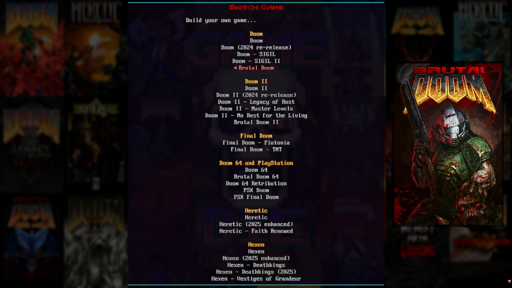
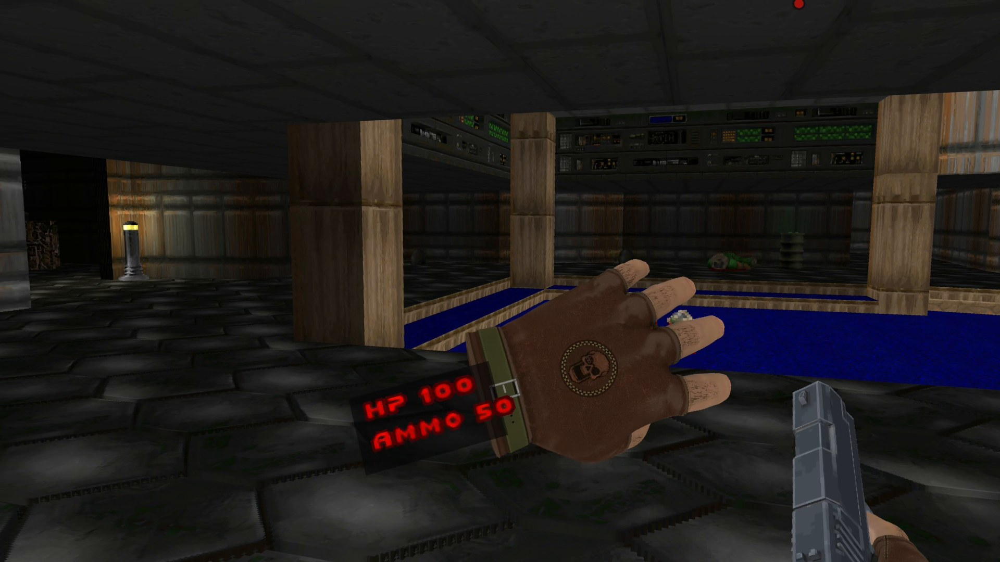
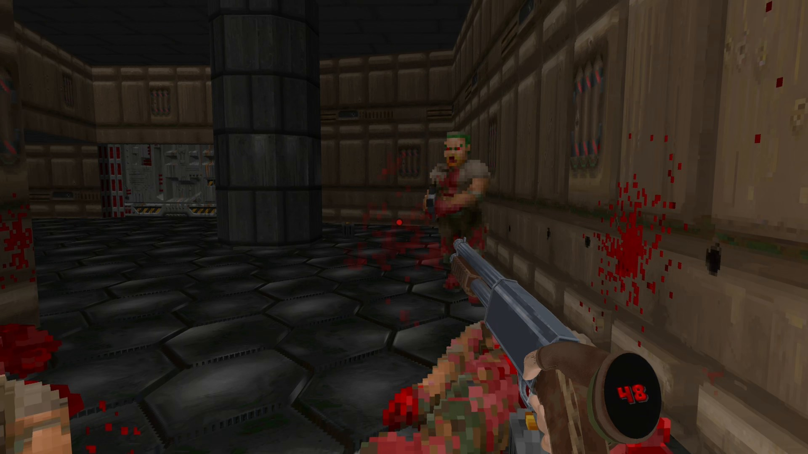
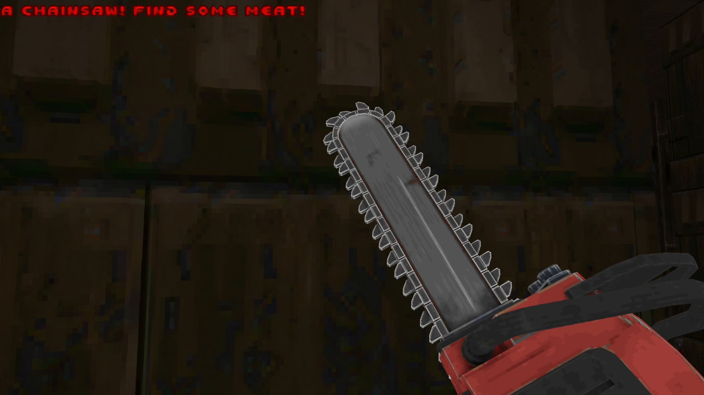
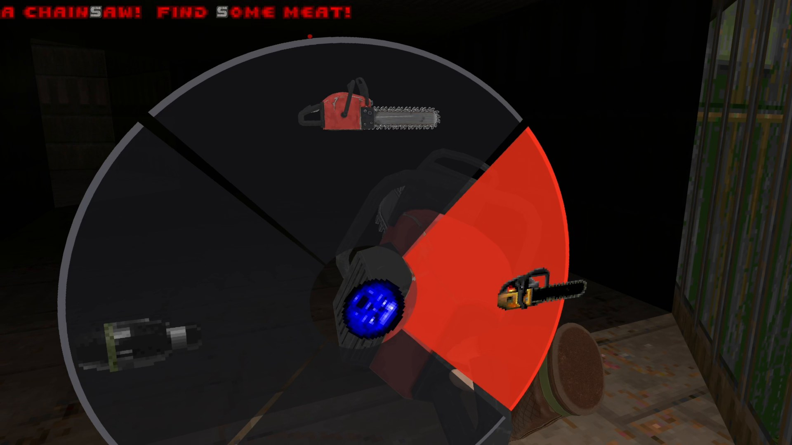
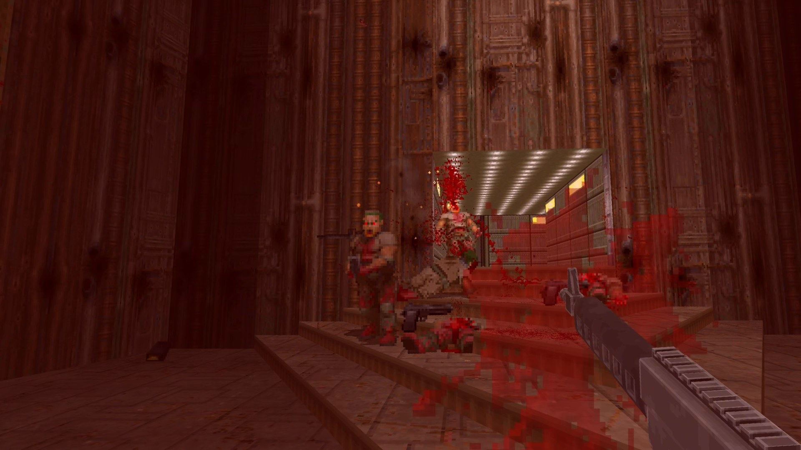
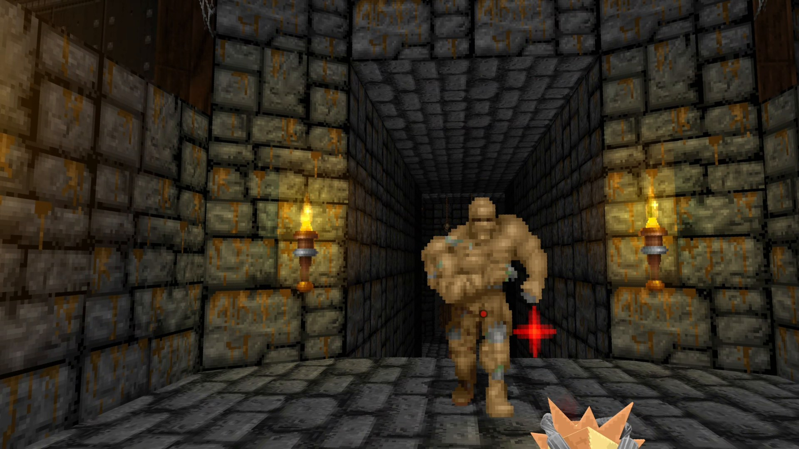
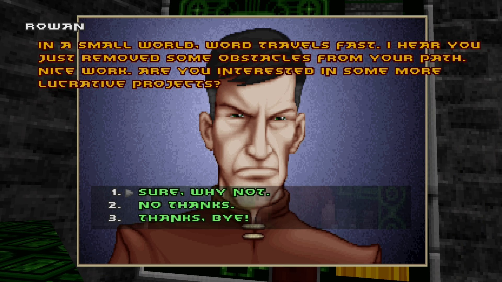

# Doom VR

Doom VR is a Game Or Die project: Doom, Doom II, Final Doom, Doom 64, Heretic, Hexen, Strife and
dozens of megawads and mods in PC VR, and standalone on the Meta Quest 3 and the Steam Frame,
built on [UZDoom](https://github.com/UZDoom/UZDoom) 5.0.1.

## Install

1. Download **[Doom VR Installer.exe](https://github.com/GameOrDie007/Doom-VR/releases/latest/download/Doom.VR.Installer.exe)**
   and double-click it. Windows may say "Windows protected your PC": click **More info**, then
   **Run anyway**.
2. Press **INSTALL**. It finds your Doom-family games on Steam and GOG, copies them in, and
   downloads the free games and mods. The first install is about 5.5 GB: about 6 minutes on a fast
   connection.
3. Start your VR runtime (Virtual Desktop, SteamVR or Quest Link) and press **PRESS START**, or use
   the **Doom VR** shortcut on your desktop. The game picker opens on Doom; pick any game.

**Installing by hand:** download `Doom-VR-1.2-PCVR.zip` from
[release 1.2](https://github.com/GameOrDie007/Doom-VR/releases/tag/v1.2), extract it anywhere and run **Setup.bat** in the extracted folder. Own a game somewhere Setup doesn't look? Drop its folder
onto Setup.bat.

You need Windows 10 or 11 (64-bit), a PC VR headset with an OpenXR runtime, a graphics card that
handles PC VR, and your own copies of the commercial games. The free games (Freedoom, Blasphemer,
Chex Quest 3, HacX and more) and the megawads need nothing.

**Updating keeps your saved games, your settings, your weapon and hand fits and your Game Tome
notes.** Run the new version's Setup.bat, or update in the installer.

**Tested on:** Meta Quest 3 over Virtual Desktop, on an RTX 3080 Ti and an RTX 5080, at 90 frames a
second; the Steam Frame through SteamVR. Valve Index, Vive and Windows Mixed Reality controllers are
supported but not yet tested by us. Standalone: Meta Quest 3 at 90 Hz (Doom at 76 to 84 frames a
second, Brutal Doom 64 at about 80); the Steam Frame standalone build is the same app and has not yet
been played on a Frame by us.

## Standalone on Meta Quest 3

Doom VR also runs on the Quest 3 by itself, with no PC while you play: the same games and mods, the
3D guns in our hands, the Game Tome, Switch Game and VR Options. Your games, mods, settings and hand
fits come from your PC's Doom VR install, so install the PC version first.

1. In the installer, pick **QUEST 3** at the top of the Doom VR card.
2. Turn the headset on, plug it into the PC with a USB-C cable, and press **INSTALL**. The first
   time, put the headset on and choose Allow.
3. On the headset: Library, Unknown Sources, **Doom VR**.

By hand: download `Doom-VR-1.1-Quest.zip` from [Releases](../../releases), unzip it on your PC and
double-click **Setup.bat**. The headset needs Developer mode, turned on once in the Meta Horizon
phone app; the download's README walks through it. Run the installer or Setup again after an
update: it copies only what changed and keeps your saved games and settings.

## Standalone on Steam Frame

The same download runs on a Valve Steam Frame with no PC, in the Frame's own library.

1. On the Frame, once: Settings, System, Enable Developer Mode; Settings, Developer, Set User
   Password; and install Lepton from the Store.
2. With the Frame on and on the same home network as the PC, pick **STEAM FRAME** at the top of
   the Doom VR card in the installer and press **INSTALL** (by hand: **Setup Steam Frame.bat** in
   the unzipped download). The first time, it pairs with the Frame: on the Frame, Settings,
   Developer, Pair new host, then Accept.
3. On the Frame: Library, **Doom VR**.

## Video and screenshots

**Watch:** [I Put Every Classic Doom in VR (and It's the Ultimate Version)](https://youtu.be/VgXECAWzyDc)

| | |
|---|---|
|  |  |
| The game picker | Health and ammo on your wrist |
|  |  |
| Two hands on the shotgun | The 3D chainsaw |
|  |  |
| The weapon wheel | Brutal Doom |
|  |  |
| Heretic | Strife |

## What you get

- **PC VR, Quest 3 and Steam Frame.** The PC version, and the same Doom VR as an app on the
  Quest 3 and the Steam Frame, with no PC while you play.
- **Every game in one place.** The game picker lists them all, grouped, with covers, and Switch
  Game in the main menu brings it back any time: pick a game and it loads in a second or two,
  without leaving the headset. Build Your Own Game puts a game together with maps, a gameplay mod,
  looks, sounds and music.
- **Your own WADs.** Put WAD and pk3 files in the **My WADs** folder (in Doom VR's game folder)
  and each one shows up in the game picker under My WADs, and in Build Your Own Game.
- **Modern VR or Classic.** Modern, the default, adds what fits each game: Voxel Doom, NashGore
  with voxel gore, upscaled textures, HD sounds and remastered music. Classic is the game as it was
  made.
- **3D guns in your hands.** Every weapon in Doom, Doom II, Final Doom, Doom 64 and Heretic is a 3D
  model held in our own hands, with a trigger finger, recoil and a punch you throw yourself. Shots
  leave each gun's own barrel.
- **Physical play.** Two holsters on your body (your pistol on the hip, your long gun on the
  shoulder), swing to strike with fists and melee weapons, two hands on long guns, push switches
  and doors by hand, use items at your mouth, and health, armor and ammo on your wrist.
- **The Game Tome.** The game's manual as a book in your hand: both palms up for a second opens it.
  Write notes in it with the pen or the PC keyboard.
- **Room-scale and crouching for real**, a weapon wheel, the red dot, controller vibration, photo
  mode, left-handed play, a steady observer view on the monitor for streaming, and VR Options in
  short pages.
- **Brutal Doom (on Doom and on Doom II), Brutal Doom 64, Project Brutality, MeatGrinder,
  Beautiful Doom, DOOM CE** and more, set up for you.

## FAQ

- **Is it free?** Yes, always.
- **Do I need my own games?** For Doom, Doom II, Final Doom, Doom 64, Heretic, Hexen and Strife,
  yes: Steam or GOG, the classic releases and the re-releases alike.
- **Which headsets?** Any PC VR headset with an OpenXR runtime: Virtual Desktop, Steam Link, Quest
  Link or Air Link, Index, Vive, Windows Mixed Reality, and the Steam Frame through SteamVR. And
  standalone on the Quest 3 and the Steam Frame.
- **Standalone on a Quest 3 or the Steam Frame?** Yes, since 1.1: see Standalone above. The games
  come from your PC's Doom VR install.
- **Can I add my own WADs?** Yes: put them in `VR\game\My WADs` and pick them at the bottom of the
  game picker. A WAD with Doom 1 maps plays on Doom, anything else on Doom II; for another game,
  put it in a folder named after that game in the picker (`My WADs\Heretic`). The Modern looks
  that would clash with its own monsters or textures are left out for it.
- **Multiplayer?** Single player for now.
- **Are my saves safe?** Yes, and updating keeps them.
- **What PC do I need?** One that runs PC VR well. On a weaker PC, set Weapon detail to Standard
  and play the Classic style.
- **Left-handed? Seated?** Yes: the Leftorium (left-handed) in VR Options, and Seated reach for
  the holsters.
- **It started on the monitor, not in the headset.** Start your VR runtime first, then Doom VR.
  Still flat, or something broke? Run **Collect logs.bat** in the VR folder (or press **logs** in
  the installer) and open an issue on this page with the zip and a line about what happened.

## Known issues

- Room-scale and crouching for real work in single player only.
- A mod with its own weapon art shows that art in your hand, made 3D, without our hands.
- Brutal Doom's spent shells come out a little low.

## Credits

- **UZDoom**, and ZDoom and GZDoom before it: the engine, by their teams and contributors. Doom VR
  started from UZDoom's [5.0.1 release](https://github.com/UZDoom/UZDoom/releases/tag/5.0.1)
  (commit b92a83674b).
- **id Software** for Doom, **Raven Software** for Heretic and Hexen, **Rogue Entertainment** for
  Strife, **Midway** and **Nightdive Studios** for Doom 64.
- The **Khronos Group** for OpenXR.
- The games and mods Setup downloads belong to their authors. Most come from their own pages; the
  ones on sites that block downloads by script come, unmodified, from Doom VR's
  [mods page](https://github.com/GameOrDie007/Doom-VR/releases/tag/mods-1), which names and links
  every author. Among them: Freedoom, the Blasphemer team, Cheello (Voxel Doom II), Nash Muhandes
  (NashGore NEXT), molecicco (DOOM CE), Per Kristian Risvik (Sounds Remastered), Andrew Hulshult
  (IDKFA), Sergeant Mark IV (Brutal Doom), and the authors of every megawad and total conversion
  in the list.

## Source and building

`source/` is Doom VR: UZDoom 5.0.1 with the VR mode added. `pcvr-xr/` is Game Or Die's OpenXR
layer, built into the program. To build on Windows with Visual Studio 2019 or later and CMake:

```
cmake -S pcvr-xr -B pcvr-xr/build-x64-mt -A x64 -DPCVRXR_STATIC_CRT=ON
cmake --build pcvr-xr/build-x64-mt --config Release --target pcvrxr
cmake -S source -B build -A x64 -DDOOMVR_PCVRXR=ON -DPCVRXR_DIR=%CD%/pcvr-xr
cmake --build build --config Release
```

The headset app (Quest 3 and Steam Frame) builds from the same tree with the Android NDK and Gradle:
`source/tools/build-quest.ps1`, whose header lists what it needs.

## License

Doom VR's program is GPL-3.0-or-later, like UZDoom, and so is pcvr-xr. Game Or Die's own work
that ships with it - the Game Tome, Game Or Die Hands and the 3D gun packs, the covers, splash and
backdrop, and the Setup scripts - is all rights reserved: it may be redistributed only as part of
Doom VR, unchanged. The Game Or Die name and logo are not licensed for any other use. Third-party
licenses ship in the release's `licenses` folder and `licenses.zip`.
